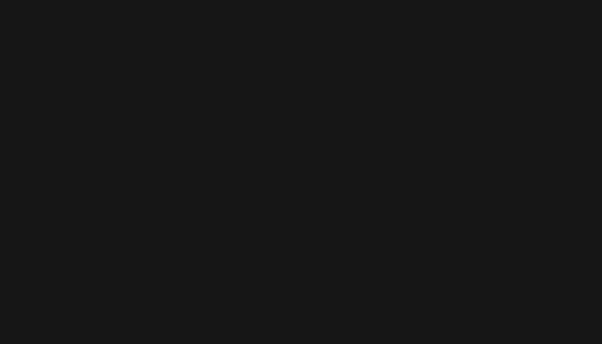
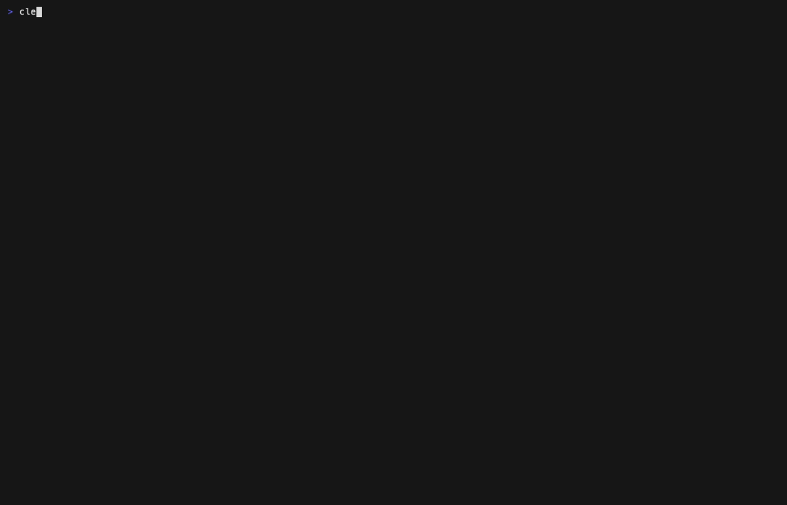

# outflow

Find which Kubernetes workloads reach the internet, and where that traffic goes.

outflow is a read-only CLI and terminal UI. For each workload it shows what its
NetworkPolicy allows, which external destinations it actually talked to, and
where those destinations are (country, or cloud provider and region). If you
define a data-residency rule such as "traffic must stay in the US", it marks
every destination and workload as inside, outside or unknown, worst first, and
tells you how sure it is.



## Install

**macOS (Homebrew)**

```sh
brew install jbrathwa/tap/outflow
```

**Linux** (VMs and CI runners; use `Linux_arm64` on ARM)

```sh
curl -sSLO https://github.com/jbrathwa/outflow/releases/latest/download/outflow_Linux_x86_64.tar.gz
curl -sSLO https://github.com/jbrathwa/outflow/releases/latest/download/checksums.txt
sha256sum --ignore-missing -c checksums.txt
tar xzf outflow_Linux_x86_64.tar.gz outflow
sudo install outflow /usr/local/bin/
```

**Windows** (PowerShell)

```powershell
Invoke-WebRequest https://github.com/jbrathwa/outflow/releases/latest/download/outflow_Windows_x86_64.zip -OutFile outflow.zip
Expand-Archive outflow.zip -DestinationPath outflow
.\outflow\outflow.exe version
```

**With Go**

```sh
go install github.com/jbrathwa/outflow@latest
```

Every build is on the [releases page](https://github.com/jbrathwa/outflow/releases),
with a `checksums.txt` to verify downloads. `outflow version` shows the version,
commit and build date.

## Try it in 10 seconds

```sh
outflow --demo --demo-rule
```

`--demo` loads a built-in, entirely fictional cluster (`aks-prod-eus`).
`--demo-rule` applies the rule "allow US". Leave `--demo-rule` off to see the
same facts with no pass/fail judgement.

## Commands

| Command | What it does |
|---|---|
| `outflow` | Interactive view (TUI) |
| `outflow scan` | Same analysis without the TUI. JSON by default (`--json`), `--format md` for a CI job summary. `--fail-on` sets the exit code |
| `outflow doctor` | Checks every data source outflow needs and reports coverage as `FULL`, `PARTIAL` or `NONE` |
| `outflow snapshot -o <file>` | Collects live data into a snapshot JSON file for offline use |
| `outflow version` | Prints the version |

Common flags: `--demo`, `--demo-rule`, `--snapshot <file>`, `--dump-demo`,
`--config <file>`, `--context`, `--profile`, `--since`, `--workspace`, `--join-window`, `--debug`. `scan` adds `--format json|md` (`--json` is short for `--format json`), `--fail-on outside|unknown`
and `--allow-partial`. Every flag, the exit codes and the `outflow.yaml`
reference are in the [usage guide](docs/usage.md).

## Sample report

`outflow scan --demo --demo-rule --format md`:

```
# outflow report

Cluster **aks-prod-eus** · rule: allow US · window 2026-11-06T09:00:00Z → 2026-11-07T09:00:00Z (UTC, RFC3339)

Coverage: FULL

| Status | Workload | Destination | Location | Evidence | Action |
|---|---|---|---|---|---|
| outside | payments/ledger-worker | stledgerweu.blob.core.windows.net (20.60.40.4):443 | NL (azure:westeurope) | confirmed | allow |
| unknown | payments/ledger-worker | login.microsoftonline.com (20.190.151.68):443 | global | confirmed | allow |
| outside | analytics/event-collector | api.eu.segment.io (52.209.81.3):443 | IE (aws:eu-west-1) | confirmed | allow |
| outside | (node) aks-np1-vmss0003 | 51.15.22.140:123 | FR | node-level | allow |
| unknown | ml/model-fetch | huggingface.co (13.33.30.71):443 | global | confirmed | allow |
| unknown | ml/model-fetch | storage.googleapis.com (142.250.80.27):443 | global | confirmed | allow |
| unknown | ml/model-fetch | models.fetch-hub.example (52.210.17.44) | IE (aws:eu-west-1) | DNS only | — |
```

With a rule, the report lists only destinations that are outside or unknown.
Without one it lists every destination with its location.

## TUI keys

| Key | Action |
|---|---|
| `↑` / `↓` (`k` / `j`) | Move |
| `enter` / `esc` | Focus the detail pane / go back |
| `ctrl+u` / `ctrl+d` | Scroll the detail pane |
| `/` | Filter by text |
| `f` | Cycle the status filter |
| `e` | Show an exception snippet for the selected destination. Copy it into `outflow.yaml` by hand; outflow never writes files |
| `r` | Rerun the queries |
| `?` | Help |
| `q` | Quit |

## Doctor

`outflow doctor` explains what is missing and how to fix it. This is the demo
cluster with CoreDNS query logging switched off:



## Docs

- [Usage guide](docs/usage.md): flags, exit codes, `outflow.yaml`, counting rules, CI example
- [Demo walkthrough](docs/demo.md): what each demo workload shows and why
- [Setup guide](docs/setup.md): turning on the data sources outflow reads
- [Releasing](docs/releasing.md): how a tagged release is built and published

## How it stays honest

- Read-only. outflow never changes a cluster, firewall or cloud resource, and
  writes no files (`--dump-demo` prints to stdout).
- Firewall-denied traffic never counts as a violation; it is shown, marked denied.
- A destination with no reliable location (anycast, CDN, no match) is `unknown`,
  never guessed.
- A clean `--fail-on` result on partial data is not a pass: it exits 1 unless
  you pass `--allow-partial`.
- outflow reports where a server is, not where a SaaS vendor stores your data.
  Known SaaS domains carry a note to check the vendor's region.

## Location data

A live scan refreshes stale or missing public cloud, CDN and country ranges first (public
files only, no Azure or Kubernetes access); the built-in seed subset is the fallback and the
demo data. Use `--no-refresh` to skip it, or `outflow update-data` to fetch now; see the
[usage guide](docs/usage.md#location-data).

IP to Country Lite data by DB-IP (https://db-ip.com), licensed under CC BY 4.0.

## License

MIT, see [LICENSE](LICENSE). The embedded DB-IP data is licensed separately under CC BY 4.0 (see above).
