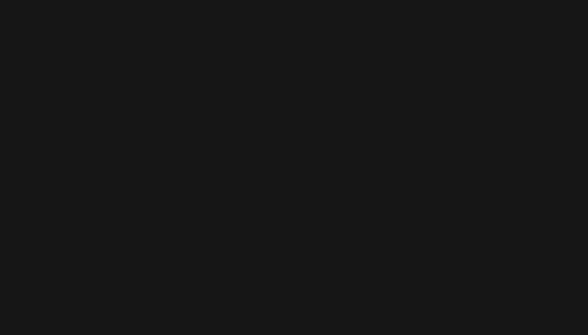
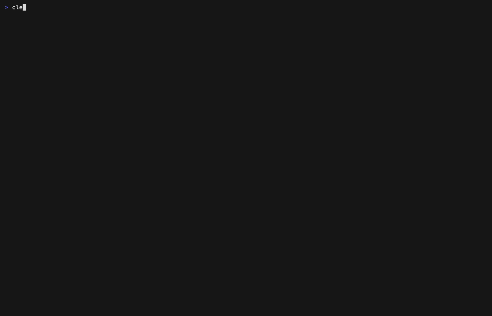

# Demo walkthrough

`outflow --demo` loads a built-in snapshot of a fictional cluster: AKS
`aks-prod-eus` in `eastus`, Azure CNI Overlay, Calico, egress through Azure
Firewall `fw-hub-eus`, logs in workspace `law-hub-eus`. Names are fictional;
destination IPs come from public provider ranges, so the location lookup has
something real to match. Everything here is real output from the binary.

```sh
outflow --demo --demo-rule     # TUI with the rule "allow US"
outflow --demo                 # same facts, no rule
outflow scan --demo --demo-rule --format md
outflow doctor --demo-degraded
```

The rule behind `--demo-rule` is:

```yaml
residency:
  allow:
    countries: [US]
  exceptions:
    - domain: api.stripe.com
      reason: "Payment processor, DPA signed"
```



## Each workload and why it got its status

With the rule, the table is sorted worst first: outside, unknown, inside, no
traffic.

| Workload | Egress | Status | Why |
|---|---|---|---|
| payments/ledger-worker | unrestricted | outside | `stledgerweu.blob.core.windows.net` is in Azure `westeurope` (NL) and traffic to it was confirmed. `login.microsoftonline.com` is a global service with no single location, so it is unknown. `api.github.com` is US but only looked up (`DNS only`) |
| analytics/event-collector | internet | outside | `api.eu.segment.io` is AWS `eu-west-1` (IE) and confirmed. `api.segment.io` is US. A third destination, `telemetry.collector.example` (FR), was blocked by the firewall: it shows as `outside (denied)` and does not count. The workload is outside only because of the allowed EU destination |
| (node) aks-np1-vmss0003 | node | outside | `51.15.22.140:123` (FR, GeoIP) is firewall traffic with no matching DNS lookup. `packages.microsoft.com` (Azure `eastus`, US) is node-exporter's `hostNetwork` lookup from the node IP, joined to firewall traffic at node level. No workload can be named for either, so the row is the node |
| ml/model-fetch | unrestricted | unknown | `huggingface.co` is a CDN and `storage.googleapis.com` is global, so neither has a location. `models.fetch-hub.example` resolves to AWS `eu-west-1` but was only looked up (`DNS only`), so it counts as unknown, not outside |
| shop/storefront | allowlist:443 | inside | `stshopassets.blob.core.windows.net` is Azure `eastus`. A firewall deny to `api.segment.io` is shown but never counted |
| payments/payment-api | internet:443 | inside | `api.stripe.com` is covered by the exception and flagged as a SaaS domain; `hooks.slack.com` is US. `api.github.com` is `likely`, see below |
| flux-system/source-controller | unrestricted | inside | `github.com`, `ghcr.io` and `api.github.com` are all US |
| monitoring/node-exporter | hostNetwork | no traffic | A `hostNetwork` pod is not covered by NetworkPolicy and looks up DNS from the node IP, so its traffic (`packages.microsoft.com`) appears under the `(node) aks-np1-vmss0003` row. The detail pane says so |
| shop/cart | internal | no traffic | Its policy only allows in-cluster peers, and nothing external was seen |

Header counts are `[3 outside] [4 unknown] [10 inside]` (destinations, with
denied traffic excluded from the outside count).

## The `likely` evidence level

`payments/payment-api` and `flux-system/source-controller` both looked up
`api.github.com` within the same window on the same node. The firewall saw one
flow from the node, so it cannot say which workload made it. Both get `likely`
instead of `confirmed`, and the detail pane for each names the other.

## Node-level rows

The `(node) aks-np1-vmss0003` row holds traffic that only the node can be
blamed for: firewall traffic that no DNS lookup explains, such as the
hard-coded IP `51.15.22.140:123`, and lookups made from the node IP by
`hostNetwork` pods, such as node-exporter's `packages.microsoft.com`. outflow
refuses to assign either to a workload, because that would claim more than the
evidence shows. A `hostNetwork` lookup with no matching firewall traffic would
be `DNS only` on this row, so it counts as unknown, never outside.

## Neutral mode

Without `--demo-rule` outflow makes no judgement. The Markdown report lists every
destination with its location instead of a status:

```
$ outflow scan --demo --format md
| Locations | Workload | Destination | Location | Evidence | Action |
|---|---|---|---|---|---|
| IE (aws:eu-west-1) | analytics/event-collector | api.eu.segment.io (52.209.81.3):443 | IE (aws:eu-west-1) | confirmed | allow |
| US (aws:us-east-1) | analytics/event-collector | api.segment.io (54.145.112.20):443 | US (aws:us-east-1) | confirmed | allow |
| FR | analytics/event-collector | telemetry.collector.example (51.15.88.12):443 | FR | confirmed | deny |
| US (aws:us-east-1) | payments/payment-api | api.stripe.com (3.218.180.12):443 | US (aws:us-east-1) | confirmed | allow |
| US (aws:us-east-1) | payments/payment-api | hooks.slack.com (3.211.44.9):443 | US (aws:us-east-1) | confirmed | allow |
...
```

In the TUI the status column becomes a locations column and the header shows
counts only. `--fail-on` is refused in this mode:

```
$ outflow scan --demo --fail-on outside
outflow: --fail-on needs a residency rule in outflow.yaml
```

## Exit codes on the demo

```
$ outflow scan --demo --demo-rule --fail-on outside > /dev/null; echo $?
2
```

## Doctor on a degraded cluster

`--demo-degraded` is a hidden flag that shows a cluster where CoreDNS query
logging is off. outflow can still see what left via the firewall, but not which
workload made each call. It exits 1 because CoreDNS logs are required on Azure CNI Overlay.



```
outflow doctor  context aks-prod-eus · profile azure

Cluster
  ✔ Kubernetes API          read-only access to aks-prod-eus
  ✔ Platform                AKS · eastus
  ✔ CNI                     Azure CNI Overlay
    pods leave with node IPs → workload names come from DNS logs
  ✔ NetworkPolicy engine    Calico

Traffic
  ✔ Outbound path           userDefinedRouting → Azure Firewall fw-hub-eus
  ✔ Firewall logs           fw-hub-eus → law-hub-eus (AZFWApplicationRule, AZFWNetworkRule)
  ✖ CoreDNS query logs      log plugin not enabled in coredns-custom
    fix: add `log` to the coredns-custom ConfigMap (docs/setup.md#coredns)
    without it: destinations only per node, not per workload
  ✖ Log collection          no CoreDNS query lines in ContainerLogV2
    fix: include kube-system in the Container Insights data collection rule
    without it: destinations only per node, not per workload
  ✔ Pod inventory           KubePodInventory in law-hub-eus

Location
  ✔ Cloud IP ranges         seed-2026-11-07
  ✔ GeoIP database          country ranges loaded

Residency
  · Rule                    not configured

Access  (least privilege)
  · checked in live mode

Coverage  PARTIAL
  can:    which workloads may reach the internet · what left via the firewall, per node
  cannot: which workload made each call → enable CoreDNS logs
```

On a healthy cluster (`outflow doctor --demo`) every traffic check is green and
the verdict is `Coverage  FULL`.

## Recording the GIFs

The GIFs are generated by [VHS](https://github.com/charmbracelet/vhs) from
`demo.tape` and `doctor.tape`, so they stay in sync with the binary:

```sh
go build -o /tmp/outflow-bin/outflow .
PATH=/tmp/outflow-bin:$PATH vhs docs/demo.tape
PATH=/tmp/outflow-bin:$PATH vhs docs/doctor.tape
```
